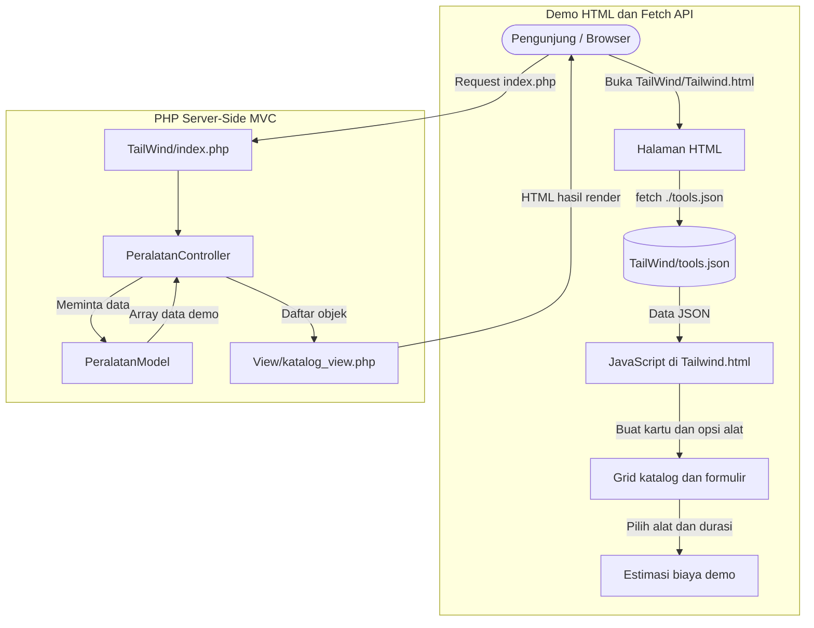

# dokumentasi proyek website promosi dan katalog sewa alat bangunan

Halo, kami dari tim pengembang yang mengembangkan website BangunSewa, yaitu
website informasi dan katalog sewa alat bangunan. Dokumen ini menjelaskan
implementasi yang tersedia di folder proyek, mulai dari halaman HTML statis,
penyempurnaan tampilan dengan CSS, pemuatan data JSON menggunakan Fetch API,
hingga pemisahan kode PHP menggunakan pola Model-View-Controller (MVC).

Proyek ini membahas penyewaan alat bangunan, bukan pemesanan makanan/minuman
atau pemesanan melalui QR code.

---

## Daftar Isi

- [Gambaran Umum](#gambaran-umum)
- [Arsitektur dan Alur Data](#arsitektur-dan-alur-data)
- [Struktur Proyek](#struktur-proyek)
- [Week 2: Struktur HTML Semantik dan Konten Promosi](#week-2-struktur-html-semantik-dan-konten-promosi)
  - [Task 01: Menyusun Struktur Halaman](#task-01-menyusun-struktur-halaman)
  - [Task 02: Membuat Katalog Alat](#task-02-membuat-katalog-alat)
  - [Task 03: Menyediakan Informasi dan Kontak](#task-03-menyediakan-informasi-dan-kontak)
- [Week 3: Sistem Desain dan Tata Letak Responsif](#week-3-sistem-desain-dan-tata-letak-responsif)
  - [Task 01: Menggunakan CSS Eksternal](#task-01-menggunakan-css-eksternal)
  - [Task 02: Menyusun Layout Responsif](#task-02-menyusun-layout-responsif)
  - [Task 03: Penyempurnaan Visual](#task-03-penyempurnaan-visual)
- [Week 4: Data JSON dan Fetch API](#week-4-data-json-dan-fetch-api)
  - [Task 01: Mengambil Data Alat](#task-01-mengambil-data-alat)
  - [Task 02: Merender Katalog Secara Dinamis](#task-02-merender-katalog-secara-dinamis)
  - [Task 03: Mengelola Status Pemuatan](#task-03-mengelola-status-pemuatan)
- [Week 5: Pemodelan Data dengan PHP OOP](#week-5-pemodelan-data-dengan-php-oop)
  - [Task 01: Mendefinisikan Class PeralatanModel](#task-01-mendefinisikan-class-peralatanmodel)
  - [Task 02: Properti, Getter, dan Format Harga](#task-02-properti-getter-dan-format-harga)
  - [Task 03: Menyediakan Data Katalog](#task-03-menyediakan-data-katalog)
- [Week 6: Menyiapkan View Katalog PHP](#week-6-menyiapkan-view-katalog-php)
  - [Task 01: Menampilkan Daftar Alat](#task-01-menampilkan-daftar-alat)
  - [Task 02: Menyediakan Formulir Permintaan](#task-02-menyediakan-formulir-permintaan)
  - [Task 03: Menampilkan Informasi Hero](#task-03-menampilkan-informasi-hero)
- [Week 7: Arsitektur Model-View-Controller](#week-7-arsitektur-model-view-controller)
  - [Task 01: Memisahkan Model, Controller, dan View](#task-01-memisahkan-model-controller-dan-view)
  - [Task 02: Menjalankan Alur Controller](#task-02-menjalankan-alur-controller)
  - [Task 03: Menghubungkan Halaman Bootstrap](#task-03-menghubungkan-halaman-bootstrap)
- [Skema Data Alat](#skema-data-alat)
- [Spesifikasi Status Fetch](#spesifikasi-status-fetch)
- [Panduan Pengembangan Lokal](#panduan-pengembangan-lokal)
- [Fitur yang Belum Diimplementasikan](#fitur-yang-belum-diimplementasikan)
- [Konvensi Kode dan Catatan Implementasi](#konvensi-kode-dan-catatan-implementasi)

---

## Gambaran Umum

BangunSewa adalah website promosi dan katalog sewa alat bangunan. Pengunjung
dapat melihat nama, kategori, deskripsi, foto, serta harga sewa harian
beberapa alat. Pada halaman demo berbasis HTML, pengunjung dapat memilih alat
dan melihat simulasi estimasi biaya berdasarkan lama sewa.

Repositori memperlihatkan perkembangan implementasi antarmuka:

- **HTML semantik:** halaman promosi berisi beranda, katalog, informasi
  penyewaan, dan kontak penyedia.
- **CSS responsif:** halaman dikembangkan dari tampilan dasar menjadi layout
  kartu dan hero yang beradaptasi pada layar kecil.
- **Fetch API:** halaman `TailWind/Tailwind.html` memuat enam data alat dari
  berkas `TailWind/tools.json`, kemudian membangun kartu dan opsi formulir.
- **PHP OOP dan MVC:** halaman `TailWind/index.php` menjalankan Controller,
  yang meminta data dari Model, membuat objek alat, dan memberikan data kepada
  View.

### Karakteristik Aplikasi

- **Fokus domain:** informasi penyewaan alat bangunan dan harga per hari.
- **Dua jalur katalog:** demo sisi klien berbasis JSON dan halaman sisi server
  berbasis PHP MVC.
- **Data contoh:** data belum disimpan di basis data.
- **Formulir demo:** formulir pada halaman HTML hanya memberikan konfirmasi di
  browser; tidak membuat transaksi atau mengirim data ke layanan eksternal.
- **Tidak memerlukan backend REST pada demo Fetch:** `Tailwind.html` membaca
  file JSON statis melalui server HTTP lokal.

---

## Arsitektur dan Alur Data

Proyek memiliki dua jalur katalog yang berjalan terpisah:



Jalur Fetch membaca `tools.json`, sedangkan jalur PHP memakai array data yang
ditulis di `PeralatanModel::getAllData()`. Kedua sumber data tersebut belum
terhubung satu sama lain; perubahan pada salah satu sumber tidak otomatis
mengubah yang lain.

---

## Struktur Proyek

Struktur utama proyek yang relevan dengan dokumentasi ini:

```text
Promosi/
├── Pertama/
│   └── Index.html                 # Halaman promosi awal
├── Kedua/
│   ├── Index.html                 # Halaman promosi dengan stylesheet eksternal
│   └── style.css                  # Styling awal dan media query
├── Ketiga/
│   ├── Index.html                 # Halaman promosi dengan visual yang disempurnakan
│   └── Style.css                  # Styling responsif versi berikutnya
└── TailWind/
    ├── Controller/
    │   └── PeralatanController.php
    ├── Model/
    │   └── PeralatanModel.php
    ├── View/
    │   └── katalog_view.php
    ├── Tailwind.html              # Demo Fetch API dan simulasi permintaan
    ├── tools.json                 # Data untuk demo Fetch API
    ├── index.php                  # Bootstrap PHP MVC
    ├── main.css                   # Sumber CSS Tailwind
    └── output.css                 # Hasil keluaran CSS Tailwind
```

Nama folder `TailWind` menggunakan kapitalisasi tersebut pada sistem berkas
proyek. Jalur file dan tautan sebaiknya mempertahankan ejaan nama folder yang
sesuai.

---

## Week 2: Struktur HTML Semantik dan Konten Promosi

Tahap awal menyusun halaman informasi BangunSewa menggunakan elemen HTML
semantik. Halaman memperkenalkan layanan, memperlihatkan beberapa contoh alat,
menjelaskan tujuan website, dan menyediakan tautan untuk menghubungi penyedia.

### Task 01: Menyusun Struktur Halaman

Halaman menggunakan struktur utama HTML5:

- `<header>` sebagai area identitas dan navigasi.
- `<nav>` untuk tautan ke bagian halaman.
- `<main>` sebagai wadah konten utama.
- `<section>` untuk bagian beranda, katalog, tentang, dan kontak.
- `<article>` untuk masing-masing kartu alat.
- `<footer>` untuk informasi penutup.

Contoh struktur yang digunakan:

```html
<header class="navbar">
  <div class="container nav-content">
    <h1 class="logo">Bangun<span>Sewa</span></h1>
    <nav>
      <a href="#beranda">Beranda</a>
      <a href="#alat">Daftar Alat</a>
      <a href="#tentang">Tentang</a>
      <a href="#kontak">Kontak</a>
    </nav>
  </div>
</header>

<main>
  <section id="beranda" class="hero">
    <!-- Konten pengenalan layanan -->
  </section>
  <section id="alat" class="section">
    <!-- Katalog alat -->
  </section>
</main>
```

Tautan navigasi menggunakan fragment ID, sehingga pengguna berpindah ke bagian
terkait di halaman yang sama.

### Task 02: Membuat Katalog Alat

Katalog awal menampilkan contoh Bor Tangan, Gerinda, dan Tangga. Setiap kartu
memuat nama, deskripsi singkat, harga per hari, dan tautan menuju bagian
kontak. Pada tahapan HTML awal, data kartu ditulis langsung di markup.

Contoh isi satu kartu:

```html
<article class="tool-card">
  <div class="tool-image">🔩</div>
  <div class="tool-info">
    <h3>Bor Tangan</h3>
    <p>Cocok untuk pekerjaan pengeboran ringan hingga sedang.</p>
    <strong>Mulai Rp50.000/hari</strong>
    <a href="#kontak" class="card-button">Tanya Informasi</a>
  </div>
</article>
```

Konten pada tahap ini bersifat statis. Belum ada filter, pencarian, paginasi,
keranjang, ataupun proses pemesanan.

### Task 03: Menyediakan Informasi dan Kontak

Bagian tentang menjelaskan fungsi website sebagai media informasi penyewaan.
Bagian kontak menyediakan tombol WhatsApp yang pada halaman HTML awal
mengarah ke nomor contoh yang tertulis di markup. Nomor tersebut perlu
diganti dengan nomor penyedia yang benar sebelum website digunakan secara
publik.

---

## Week 3: Sistem Desain dan Tata Letak Responsif

Pada tahap berikutnya, styling dipisahkan ke stylesheet eksternal dan layout
halaman dirapikan agar mudah dibaca pada layar desktop maupun perangkat
berukuran lebih kecil.

### Task 01: Menggunakan CSS Eksternal

`Kedua/Index.html` menghubungkan stylesheet melalui elemen `<link>`:

```html
<link rel="stylesheet" href="style.css">
```

`Kedua/style.css` mengatur reset dasar, lebar container, navigasi, hero,
kartu alat, bagian kontak, footer, dan media query. Tahap berikutnya memakai
`Ketiga/Style.css` untuk menyempurnakan warna, jarak, bayangan, dan ukuran
tipografi.

### Task 02: Menyusun Layout Responsif

Layout desktop menggunakan CSS Grid untuk membagi area hero dan menyusun tiga
kartu alat. Pada lebar layar maksimal 800 piksel, media query mengubah hero
dan katalog menjadi satu kolom serta menyusun bagian kontak secara vertikal.

Contoh aturan responsif pada `Kedua/style.css`:

```css
.hero-content {
  display: grid;
  grid-template-columns: 1fr 1fr;
  align-items: center;
  gap: 40px;
}

.tool-grid {
  display: grid;
  grid-template-columns: repeat(3, 1fr);
  gap: 25px;
}

@media (max-width: 800px) {
  .hero-content,
  .tool-grid {
    grid-template-columns: 1fr;
  }
}
```

### Task 03: Penyempurnaan Visual

`Ketiga/Style.css` menambahkan warna latar, warna merek, radius kartu, efek
bayangan, dan transisi pada tombol. Elemen visual alat pada halaman ini masih
berupa emoji, bukan katalog foto yang dimuat dari data.

Kelas desain utama yang terlihat di stylesheet:

- `.navbar`, `.nav-content`, dan `.logo` untuk header.
- `.hero` dan `.hero-content` untuk pengenalan layanan.
- `.tool-grid`, `.tool-card`, dan `.tool-info` untuk katalog.
- `.contact-box` untuk ajakan menghubungi penyedia.
- Media query `max-width: 800px` untuk layout layar kecil.

---

## Week 4: Data JSON dan Fetch API

`TailWind/Tailwind.html` merupakan halaman demo yang memuat katalog alat dari
`TailWind/tools.json`. JavaScript berada di dalam file HTML dan menggunakan
Fetch API untuk mengambil data saat halaman dibuka.

### Task 01: Mengambil Data Alat

Alamat sumber data ditetapkan sebagai file JSON lokal:

```javascript
const apiUrl = './tools.json';
```

Fungsi `fetchTools()` melakukan permintaan menggunakan `async/await`, memeriksa
status HTTP, lalu membaca body respons sebagai JSON:

```javascript
async function fetchTools() {
  try {
    const response = await fetch(apiUrl);

    if (!response.ok) {
      throw new Error(`Permintaan gagal (HTTP ${response.status}).`);
    }

    const data = await response.json();
    const tools = data?.tools;

    if (!Array.isArray(tools)) {
      throw new Error('Format data API tidak sesuai: daftar alat tidak ditemukan.');
    }

    showApiTools(tools);
  } catch (error) {
    console.error('[BangunSewa API] Detail error:', error);
  }
}
```

Sumbernya adalah berkas JSON statis, bukan layanan REST API eksternal atau
endpoint PHP.

### Task 02: Merender Katalog Secara Dinamis

Fungsi `showApiTools(tools)` membersihkan kontainer katalog dan pilihan alat,
lalu membuat elemen DOM untuk setiap data alat. Elemen dibuat menggunakan
`document.createElement()` dan teks dimasukkan melalui `textContent`.

Selain membuat kartu, fungsi tersebut membangun `<option>` untuk formulir.
Dengan demikian pilihan alat yang tersedia berasal dari data JSON yang sama
dengan kartu katalog pada halaman tersebut.

Kartu alat menampilkan:

- Foto dan tautan atribusi foto.
- Kategori, nama, dan deskripsi alat.
- Harga sewa dalam format mata uang Rupiah.
- Tombol “Pilih untuk disewa”.

Tombol kartu mengisi pilihan alat pada formulir, memperbarui estimasi harga,
dan menggulir halaman ke bagian formulir.

### Task 03: Mengelola Status Pemuatan

Implementasi Fetch mengelola beberapa kondisi antarmuka:

- **Loading:** menampilkan spinner dan pesan proses, mengosongkan katalog lama,
  dan menonaktifkan pilihan alat.
- **Success:** membuat kartu dari data, mengaktifkan pilihan alat, lalu
  menampilkan jumlah alat yang berhasil dimuat.
- **Empty:** jika array alat kosong, menampilkan pesan bahwa belum ada alat dan
  membiarkan pilihan tetap nonaktif.
- **Error:** menampilkan pesan kesalahan, mempertahankan pilihan alat dalam
  keadaan nonaktif, dan menampilkan tombol “Muat Ulang”.

Tombol pemulihan menjalankan kembali `fetchTools()`. Proses dan hasil
permintaan juga dicatat di panel log demonstrasi dan Console browser.

---

## Week 5: Pemodelan Data dengan PHP OOP

Versi PHP mendefinisikan `PeralatanModel` sebagai representasi sebuah item
alat. Class ini berada di `TailWind/Model/PeralatanModel.php`.

### Task 01: Mendefinisikan Class PeralatanModel

Class memiliki properti privat bertipe untuk menyimpan identitas, nama,
informasi gambar, kategori, deskripsi, dan harga:

```php
class PeralatanModel
{
    private int $id;
    private string $name;
    private string $imageUrl;
    private string $imageSource;
    private string $category;
    private string $description;
    private int $pricePerDay;
}
```

Constructor menerima nilai untuk seluruh properti tersebut. Controller
membuat objek dengan argumen yang dibaca dari array data.

### Task 02: Properti, Getter, dan Format Harga

Model menyediakan getter seperti `getId()`, `getName()`, `getImageUrl()`,
`getImageSource()`, `getCategory()`, `getDescription()`, dan
`getPricePerDay()`. Method `getHargaFormatted()` memformat nilai harga sebagai
Rupiah:

```php
public function getHargaFormatted(): string
{
    return "Rp " . number_format($this->pricePerDay, 0, ',', '.');
}
```

Getter digunakan oleh View untuk membaca nilai dari properti yang bersifat
privat.

### Task 03: Menyediakan Data Katalog

Method statis `getAllData(): array` mengembalikan enam entri data contoh:

1. Bor Tangan — Rp50.000 per hari.
2. Gerinda Tangan — Rp45.000 per hari.
3. Tangga Aluminium — Rp35.000 per hari.
4. Mesin Molen Beton — Rp250.000 per hari.
5. Jack Hammer — Rp200.000 per hari.
6. Mesin Pemotong Keramik — Rp75.000 per hari.

Data tersebut masih ditulis langsung di dalam class Model. Belum ada query
database atau pembacaan JSON pada jalur PHP MVC.

---

## Week 6: Menyiapkan View Katalog PHP

Template `TailWind/View/katalog_view.php` merender halaman BangunSewa
menggunakan data objek yang dikirim dari Controller.

### Task 01: Menampilkan Daftar Alat

View melakukan loop terhadap `$daftarAlat`, kemudian menggunakan getter
objek untuk menampilkan gambar, sumber gambar, kategori, nama, deskripsi,
dan harga:

```php
<?php foreach ($daftarAlat as $alat): ?>
  <article>
    getImageUrl(); ?>"
         alt="<?= $alat->getName(); ?>">
    <h3><?= $alat->getName(); ?></h3>
    <p><?= $alat->getDescription(); ?></p>
    <strong><?= $alat->getHargaFormatted(); ?>/hari</strong>
  </article>
<?php endforeach; ?>
```

Halaman juga menampilkan kartu hero menggunakan data Mesin Molen Beton dari
indeks daftar alat.

### Task 02: Menyediakan Formulir Permintaan

View menyediakan input nama penyewa, nomor telepon, dan pilihan alat.
Pilihan alat dibentuk dari objek `$daftarAlat`, agar label pilihan
menampilkan nama serta harga per hari.

Pada versi PHP saat ini, formulir belum memiliki `action`, handler
server-side, penyimpanan pesanan, atau mekanisme pengiriman permintaan.
Tampilannya merupakan bagian antarmuka, bukan transaksi sewa yang sudah
berfungsi.

### Task 03: Menampilkan Informasi Hero

Bagian beranda di View menjelaskan layanan BangunSewa, menyediakan tautan
menuju katalog dan cara sewa, serta menampilkan alat pilihan. Navigasi halaman
mengarah ke bagian katalog, cara sewa, dan formulir.

---

## Week 7: Arsitektur Model-View-Controller

Versi PHP mengatur alur aplikasi melalui tiga berkas utama: Model,
Controller, dan View. `index.php` berperan sebagai bootstrap sederhana.

### Task 01: Memisahkan Model, Controller, dan View

```text
TailWind/
├── Controller/
│   └── PeralatanController.php
├── Model/
│   └── PeralatanModel.php
├── View/
│   └── katalog_view.php
└── index.php
```

- **Model** menyediakan data contoh dan representasi objek alat.
- **Controller** menyiapkan daftar objek untuk ditampilkan.
- **View** mengubah daftar objek tersebut menjadi halaman HTML.
- **Bootstrap** membuat Controller dan memanggil method `index()`.

### Task 02: Menjalankan Alur Controller

Method `index()` pada `PeralatanController` meminta array melalui
`PeralatanModel::getAllData()`, mengiterasi data, lalu mengubah setiap entri
menjadi objek `PeralatanModel`. Setelah itu Controller memuat View:

```php
$rawData = PeralatanModel::getAllData();
$daftarAlat = [];

foreach ($rawData as $item) {
    $daftarAlat[] = new PeralatanModel(
        $item['id'],
        $item['name'],
        $item['imageUrl'],
        $item['imageSource'],
        $item['category'],
        $item['description'],
        $item['pricePerDay']
    );
}

require_once __DIR__ . '/../View/katalog_view.php';
```

Controller saat ini hanya mempunyai alur daftar katalog. Belum tersedia
pencarian, filter kategori, endpoint detail, atau routing action.

### Task 03: Menghubungkan Halaman Bootstrap

`TailWind/index.php` memuat Controller dan menjalankan method `index()`:

```php
require_once 'Controller/PeralatanController.php';

$controller = new PeralatanController();
$controller->index();
```

Dengan demikian, request ke `index.php` menjalankan alur Model → Controller
→ View dan menghasilkan halaman katalog HTML.

---

## Skema Data Alat

Data pada `tools.json` memiliki bentuk seperti berikut:

```json
{
  "tools": [
    {
      "id": 1,
      "name": "Bor Tangan",
      "imageUrl": "https://example.com/bor.jpg",
      "imageSource": "https://commons.wikimedia.org/",
      "category": "Alat listrik",
      "description": "Bor listrik untuk membuat lubang pada material.",
      "pricePerDay": 50000
    }
  ]
}
```

### Definisi Properti

| Properti | Tipe | Deskripsi |
| --- | --- | --- |
| `id` | integer | Identitas unik alat pada data demo |
| `name` | string | Nama alat bangunan |
| `imageUrl` | string | URL gambar alat |
| `imageSource` | string | Halaman sumber atau atribusi gambar |
| `category` | string | Kategori alat, misalnya Alat listrik |
| `description` | string | Deskripsi singkat fungsi alat |
| `pricePerDay` | integer | Biaya sewa harian dalam Rupiah |

Data PHP memakai konsep properti yang sama, tetapi saat ini ditulis sebagai
array terpisah di method `PeralatanModel::getAllData()`.

---

## Spesifikasi Status Fetch

Alur Fetch pada `Tailwind.html` dapat diringkas dalam status berikut:

```text
MULAI
  |
  v
LOADING -- respons valid dan data berbentuk array --> SUCCESS
  |                                                  |
  | permintaan gagal / JSON tidak sesuai             | array kosong
  v                                                  v
ERROR                                            EMPTY
  |
  └── tombol Muat Ulang --> LOADING
```

1. **`LOADING`** — pesan pemuatan dan spinner aktif, kartu lama dibersihkan,
   dan dropdown alat dinonaktifkan.
2. **`SUCCESS`** — data valid dirender menjadi kartu dan pilihan formulir.
3. **`EMPTY`** — permintaan berhasil, tetapi array alat kosong; halaman
   memberi informasi bahwa belum ada alat.
4. **`ERROR`** — pesan galat ditampilkan dan tersedia tombol untuk mencoba
   kembali.

Status ini hanya digunakan oleh halaman demo Fetch. Halaman PHP MVC dirender
secara server-side dan belum menerapkan status jaringan yang sama.

---

## Panduan Pengembangan Lokal

### Kebutuhan

- Browser modern.
- PHP untuk menjalankan halaman MVC.
- Node.js dan dependensi proyek hanya jika ingin membangun CSS Tailwind dari
  `main.css`.

### Menjalankan Halaman PHP MVC

Buka terminal pada folder `TailWind`, kemudian jalankan:

```powershell
php -S 127.0.0.1:8000
```

Buka:

- <http://127.0.0.1:8000/> atau <http://127.0.0.1:8000/index.php> untuk
  halaman PHP MVC.
- <http://127.0.0.1:8000/Tailwind.html> untuk halaman HTML dengan Fetch API.

Halaman `Tailwind.html` perlu dijalankan melalui server HTTP agar browser
dapat memuat `tools.json`; membuka halaman langsung melalui `file://` dapat
menghalangi permintaan Fetch.

### Membangun CSS Tailwind

Folder `TailWind` memiliki `main.css` sebagai sumber dan `output.css` sebagai
file hasil build. Konfigurasi CLI proyek berada di `package.json` pada root
repositori. Perintah build spesifik dapat disesuaikan dengan script yang
tersedia di `package.json`.

Halaman yang ditinjau memuat Tailwind melalui CDN, sehingga stylesheet lokal
belum menjadi sumber styling utama untuk halaman tersebut.

---

## Fitur yang Belum Diimplementasikan

Hal-hal berikut belum tersedia pada kode proyek yang ditinjau. Bagian ini
penting agar dokumentasi tidak menyatakan fitur demo sebagai fitur produksi:

- QR code untuk membuka katalog.
- Keranjang, checkout, pembayaran, atau pemrosesan transaksi sewa.
- Penyimpanan data ke database.
- Endpoint REST API PHP. Fetch pada halaman HTML membaca `tools.json`
  secara langsung.
- Sinkronisasi sumber data JSON dengan array pada Model PHP.
- Pencarian alat, filter kategori, paginasi, atau halaman detail alat.
- Penyimpanan atau pengiriman formulir permintaan PHP.
- Validasi server-side untuk formulir.
- Login, akun pelanggan, dan panel admin.
- Ketersediaan alat dan pengelolaan stok berdasarkan tanggal sewa.

---

## Konvensi Kode dan Catatan Implementasi

1. **Pemisahan tanggung jawab MVC:** Model menyediakan data dan representasi
   alat, Controller mengatur alur pemuatan, sedangkan View merender markup.
2. **Encapsulation:** properti `PeralatanModel` dideklarasikan `private` dan
   diakses lewat getter.
3. **Tipe properti:** Model menggunakan tipe `int` dan `string` untuk data
   alat.
4. **Format harga konsisten:** `getHargaFormatted()` menampilkan Rupiah
   dengan pemisah ribuan Indonesia.
5. **Status Fetch eksplisit:** halaman HTML menangani respons non-OK, bentuk
   JSON yang tidak valid, daftar kosong, serta kesalahan jaringan.
6. **Formulir masih demo:** konfirmasi pada halaman HTML tidak berarti
   pesanan tersimpan atau telah diterima penyedia.
7. **Output HTML PHP:** data Model saat ini langsung dicetak ke dalam
   atribut dan teks HTML. Jika data nantinya berasal dari input pengguna atau
   sumber luar yang tidak tepercaya, output perlu di-escape menggunakan
   `htmlspecialchars()` sesuai konteks untuk mencegah injeksi markup.
8. **Atribusi gambar:** tautan sumber foto disediakan pada katalog. Pastikan
   hak penggunaan dan atribusi tiap aset tetap sesuai dengan lisensi sumber.

---

Dokumen ini menggambarkan kondisi kode BangunSewa saat ini. Jika fitur baru
ditambahkan, dokumentasi perlu diperbarui agar alur dan batasannya tetap
sesuai dengan implementasi.
