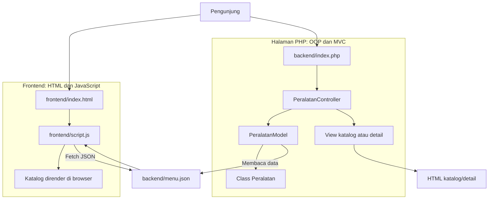

# Website Katalog Penyewaan Alat Bangunan BangunSewa

Halo, kami dari tim pengembang yang membuat website BangunSewa, yaitu website
informasi dan katalog penyewaan alat bangunan. README ini mendokumentasikan
tujuan website, alur kerja aplikasi, struktur berkas, serta materi yang
dipelajari dan diterapkan oleh setiap anggota selama pertemuan 1 sampai 7.

---

## Daftar Isi

- [Gambaran Umum](#gambaran-umum)
- [Tujuan dan Tampilan Website](#tujuan-dan-tampilan-website)
- [Pembagian Materi Anggota](#pembagian-materi-anggota)
- [Arsitektur dan Alur Data](#arsitektur-dan-alur-data)
- [Struktur Repositori](#struktur-repositori)
- [Pertemuan 1–3: Taufiurahman (Taufik)](#pertemuan-1-3-taufiurahman-taufik)
  - [Pertemuan 1: Tujuan dan Rancangan Website](#pertemuan-1-tujuan-dan-rancangan-website)
  - [Pertemuan 2: Struktur HTML](#pertemuan-2-struktur-html)
  - [Pertemuan 3: Tampilan Responsif dan Interaksi DOM](#pertemuan-3-tampilan-responsif-dan-interaksi-dom)
- [Pertemuan 4–5: Anggara Aribawa Paramesti](#pertemuan-4-5-anggara-aribawa-paramesti)
  - [Pertemuan 4: JSON dan Fetch API](#pertemuan-4-json-dan-fetch-api)
  - [Pertemuan 5: PHP Prosedural dan Pemrosesan Data](#pertemuan-5-php-prosedural-dan-pemrosesan-data)
- [Pertemuan 6–7: Muhammad Rifaldin](#pertemuan-6-7-muhammad-rifaldin)
  - [Pertemuan 6: PHP OOP](#pertemuan-6-php-oop)
  - [Pertemuan 7: Arsitektur MVC](#pertemuan-7-arsitektur-mvc)
- [Skema Data Alat](#skema-data-alat)
- [Panduan Menjalankan Proyek](#panduan-menjalankan-proyek)
- [Catatan Fitur dan Batasan](#catatan-fitur-dan-batasan)

---

## Gambaran Umum

BangunSewa membantu pengunjung menemukan alat bangunan untuk kebutuhan proyek
atau renovasi. Website menampilkan katalog alat, kategori, deskripsi, foto,
serta harga sewa per hari. Pengunjung dapat mencari dan memfilter alat,
memeriksa estimasi biaya, dan mengisi formulir permintaan sewa demo.

Proyek ini menerapkan materi pengembangan web secara bertahap:

- **Antarmuka sisi browser:** HTML, Tailwind CSS, manipulasi DOM, event
  pengguna, dan Fetch API.
- **Pemrosesan PHP:** pembacaan data JSON, fungsi bantuan, dan penyediaan
  respons JSON.
- **Pemrograman berorientasi objek:** class `Peralatan` dan
  `PeralatanModel`.
- **Arsitektur MVC:** pemisahan Model, Controller, dan View untuk halaman
  katalog PHP.

## Tujuan dan Tampilan Website

### Tujuan Website

Tujuan BangunSewa adalah menyediakan cara yang mudah untuk melihat pilihan
sewa alat bangunan tanpa perlu membeli alat yang hanya digunakan untuk
sementara. Informasi harga per hari membantu calon penyewa membandingkan
pilihan sebelum mengajukan permintaan.

### Tujuan Tampilan

Tampilan mengarahkan pengunjung melalui alur yang sederhana:

1. **Beranda** menjelaskan layanan dan menyediakan tautan menuju katalog.
2. **Katalog Alat** memperlihatkan foto, kategori, deskripsi, dan harga alat.
3. **Cara Sewa** menjelaskan langkah memilih alat, menentukan jadwal, dan
   mengajukan permintaan.
4. **Formulir Ajukan Sewa** meminta informasi penyewa, pilihan alat, tanggal
   mulai, dan lama sewa.

Warna hijau, krem, dan oranye membentuk identitas visual yang hangat dan mudah
dibaca. Tata letak dibuat responsif agar navigasi, kartu katalog, dan formulir
tetap nyaman digunakan pada layar kecil maupun besar.

## Pembagian Materi Anggota

| Anggota | Nama | Pertemuan | Materi dan hasil yang dijelaskan |
| --- | --- | --- | --- |
| Anggota 1 | Taufiurahman (Taufik) | **1, 2, dan 3** | Tujuan serta rancangan website, struktur HTML halaman, styling responsif, dan interaksi dasar DOM. |
| Anggota 2 | Anggara Aribawa Paramesti | **4 dan 5** | Data JSON dan Fetch API di sisi browser, kemudian PHP prosedural untuk membaca, memfilter, dan menyajikan data. |
| Anggota 3 | Muhammad Rifaldin | **6 dan 7** | Pemodelan alat menggunakan PHP OOP, kemudian pemisahan alur halaman dengan pola MVC. |

Pembagian ini mengikuti **pertemuan yang dibaca dan dipresentasikan**, bukan
pembagian fitur berdasarkan tiga soal. Fitur website saling berhubungan dan
berkasnya dapat disentuh oleh lebih dari satu anggota.

## Arsitektur dan Alur Data

Proyek memiliki dua jalur untuk menampilkan katalog. Halaman frontend memakai
JavaScript untuk mengambil JSON dan merender kartu di browser. Halaman PHP
MVC memproses data melalui Model dan Controller, lalu merender View di server.



**Catatan:** `frontend/script.js` mengambil data langsung dari
`backend/menu.json`, bukan dari `backend/api.php`. Endpoint PHP tetap tersedia
sebagai bagian implementasi PHP untuk memberikan data JSON.

## Struktur Repositori

```text
Tugas_Matkul_Web_J/
├── frontend/
│   ├── index.html             # Halaman BangunSewa sisi browser
│   ├── script.js              # Fetch, render katalog, dan interaksi
│   ├── main.css               # Sumber CSS Tailwind
│   └── output.css             # CSS hasil build yang tersedia
├── backend/
│   ├── classes/
│   │   └── Peralatan.php      # Class entitas alat
│   ├── controllers/
│   │   └── PeralatanController.php
│   ├── data/
│   │   └── data_menu.php      # Membaca dan memvalidasi menu.json
│   ├── helpers/
│   │   └── functions.php      # Format Rupiah dan fungsi filter
│   ├── models/
│   │   └── PeralatanModel.php # Mengubah data menjadi objek Peralatan
│   ├── views/
│   │   ├── katalog_view.php   # Tampilan katalog PHP
│   │   └── detail_view.php    # Tampilan detail alat
│   ├── api.php                # Endpoint data katalog berformat JSON
│   ├── index.php              # Bootstrap/router halaman MVC
│   └── menu.json              # Data alat bersama
├── index.php                  # Mengarahkan halaman root ke frontend
├── package.json               # Dependensi Tailwind CSS
└── Readme.md                  # Dokumentasi proyek
```

---

## Pertemuan 1–3: Taufiurahman (Taufik)

Bagian ini menjelaskan tujuan dan rancangan website, struktur HTML, styling,
serta interaksi dasar yang menjadi fokus materi anggota 1.

### Pertemuan 1: Tujuan dan Rancangan Website

**Fokus:** memahami masalah yang ingin dibantu oleh website dan menyusun alur
yang dibutuhkan pengunjung.

BangunSewa ditujukan untuk calon penyewa alat bangunan. Isi halaman disusun
agar pengunjung mengenal layanan, menemukan alat, memahami langkah sewa, dan
mencoba mengisi formulir.

```html
<section id="beranda">
  <h2>Kerja lebih siap, tanpa beli alat.</h2>
  <p>
    Sewa alat bangunan untuk kebutuhan harian proyekmu.
    Temukan alat yang tepat, cek harga, lalu ajukan permintaan sewa.
  </p>
  <a href="#alat">Jelajahi Katalog</a>
</section>
```

**Fungsi kode:** bagian beranda memperkenalkan manfaat layanan. Tautan
`href="#alat"` membawa pengunjung langsung ke bagian katalog tanpa membuka
halaman lain.

### Pertemuan 2: Struktur HTML

**Fokus:** membentuk halaman menggunakan elemen HTML yang sesuai dengan fungsi
kontennya.

Halaman menggunakan `<header>` untuk navigasi, `<main>` untuk konten utama,
`<section>` untuk bagian-bagian halaman, `<article>` untuk kelompok informasi
alat, `<form>` untuk permintaan sewa, dan `<footer>` untuk informasi penutup.

```html
<header>
  <nav aria-label="Navigasi utama">
    <a href="#beranda">Beranda</a>
    <a href="#alat">Katalog Alat</a>
    <a href="#cara-sewa">Cara Sewa</a>
    <a href="#kontak">Ajukan Sewa</a>
  </nav>
</header>

<main>
  <section id="beranda">...</section>
  <section id="alat">...</section>
  <section id="cara-sewa">...</section>
  <section id="kontak">...</section>
</main>
```

**Fungsi kode:** struktur semantik membuat pembagian konten lebih mudah
dipahami dan tautan navigasi menghubungkan menu dengan bagian yang dituju.
Atribut `aria-label` memberi nama yang dapat dikenali teknologi bantu.

### Pertemuan 3: Tampilan Responsif dan Interaksi DOM

**Fokus:** menyusun layout yang menyesuaikan ukuran layar dan memberi respons
terhadap tindakan pengunjung.

Halaman menggunakan utility Tailwind CSS dan breakpoint seperti
`max-[800px]:grid-cols-1` untuk mengubah layout kolom pada layar lebih kecil.
JavaScript mengatur menu navigasi dan fitur katalog berdasarkan event
pengguna.

```html
<div class="grid grid-cols-3 gap-5 max-[800px]:grid-cols-1">
  <!-- Langkah-langkah cara sewa -->
</div>
```

```javascript
menuButton.addEventListener('click', function () {
  const isExpanded = menuButton.getAttribute('aria-expanded') === 'true';
  menuButton.setAttribute('aria-expanded', String(!isExpanded));
  menu.classList.toggle('max-[800px]:hidden');
});
```

**Fungsi kode:**

- Class Tailwind mengatur grid tiga kolom pada layar lebar dan satu kolom pada
  layar dengan lebar maksimal 800 piksel.
- Event `click` membuka atau menutup menu pada layar kecil.
- `aria-expanded` menyatakan status menu agar statusnya dapat dikenali
  teknologi bantu.
- Event `input` pada pencarian dan event `click` pada filter kategori
  memperbarui katalog.

---

## Pertemuan 4–5: Anggara Aribawa Paramesti

Bagian ini menjelaskan pengambilan dan pengolahan data, dimulai dari JSON dan
Fetch API di browser, lalu berlanjut ke pemrosesan PHP prosedural.

### Pertemuan 4: JSON dan Fetch API

**Fokus:** memisahkan data dari markup, mengambilnya secara asynchronous, dan
menampilkan hasilnya pada halaman.

#### Task 01: Mengambil dan Memvalidasi Data

Fungsi `fetchTools()` meminta `backend/menu.json`, memastikan respons HTTP
berhasil, membaca JSON, lalu memeriksa apakah properti `tools` berupa array.

```javascript
const apiUrl = '../backend/menu.json';

async function fetchTools() {
  try {
    const response = await fetch(apiUrl);

    if (!response.ok) {
      throw new Error(`Permintaan gagal (HTTP ${response.status}).`);
    }

    const data = await response.json();
    const tools = data?.tools;

    if (!Array.isArray(tools)) {
      throw new Error('Daftar alat tidak ditemukan pada data JSON.');
    }

    availableTools = tools;
    renderCategoryFilters();
    showApiTools(tools);
  } catch (error) {
    // Kesalahan ditampilkan pada status katalog.
  }
}
```

**Fungsi kode:**

- `async` dan `await` menangani proses jaringan tanpa menghentikan alur
  halaman.
- `response.ok` memeriksa status HTTP.
- `response.json()` mengubah isi respons menjadi objek JavaScript.
- `Array.isArray()` mencegah data dengan format yang salah diproses sebagai
  daftar alat.

#### Task 02: Membuat Katalog Secara Dinamis

Fungsi `showApiTools(tools)` membuat elemen DOM untuk data alat yang diterima.
Fungsi tersebut juga mengisi pilihan alat pada formulir dan menerapkan
pencarian, filter kategori, serta batas jumlah kartu yang ditampilkan.

```javascript
tools.forEach(function (tool) {
  const card = document.createElement('article');
  const title = document.createElement('h4');
  title.textContent = tool.name;

  const description = document.createElement('p');
  description.textContent = tool.description;

  card.append(title, description);
  apiTools.append(card);
});
```

**Fungsi kode:** `forEach()` memproses setiap alat, `createElement()` membuat
elemen HTML, `textContent` mengisi teks alat, dan `append()` memasukkan elemen
ke kontainer katalog. Implementasi lengkap juga menambahkan gambar, kategori,
harga, sumber foto, dan tombol pemilihan alat.

#### Task 03: Status Pemuatan dan Pencatatan Fetch

Saat permintaan dimulai, halaman menampilkan status loading dan spinner. Jika
berhasil, katalog diperbarui. Jika gagal, pesan error dan tombol **Muat
Ulang** ditampilkan. Prosesnya juga ditulis pada panel log demonstrasi dan
Console browser.

```javascript
apiStatus.textContent = 'Loading: sedang mengambil data alat bangunan...';
apiSpinner.classList.remove('hidden');

try {
  const response = await fetch(apiUrl);
  // Memvalidasi respons dan menampilkan data.
} catch (error) {
  const message = error instanceof Error
    ? error.message
    : 'Terjadi kesalahan yang tidak diketahui.';
  apiStatus.textContent = `Gagal memuat data: ${message}`;
  apiSpinner.classList.add('hidden');
  retryButton.classList.remove('hidden');
  console.error('[BangunSewa API] Detail error:', error);
}
```

**Fungsi kode:** status dan spinner memberi tahu pengguna bahwa data sedang
dimuat. Tombol muat ulang menjalankan kembali `fetchTools()` setelah terjadi
kegagalan.

### Pertemuan 5: PHP Prosedural dan Pemrosesan Data

**Fokus:** menggunakan kode PHP dan fungsi bantuan untuk membaca, memeriksa,
memfilter, serta mengirim data katalog.

#### Task 01: Membaca Data JSON dari PHP

Fungsi `getDataMenu()` pada `backend/data/data_menu.php` membaca sumber data
yang sama dan memastikan struktur `tools` tersedia.

```php
function getDataMenu(): array
{
    $path = __DIR__ . '/../menu.json';
    $contents = file_get_contents($path);

    if ($contents === false) {
        throw new RuntimeException('Data katalog tidak dapat dibaca.');
    }

    $data = json_decode($contents, true, 512, JSON_THROW_ON_ERROR);

    if (!isset($data['tools']) || !is_array($data['tools'])) {
        throw new UnexpectedValueException('Format data katalog tidak valid.');
    }

    return $data['tools'];
}
```

**Fungsi kode:** PHP membaca berkas JSON, mengubahnya menjadi array
asosiatif, dan melaporkan error jika berkas tidak dapat dibaca atau formatnya
tidak sesuai.

#### Task 02: Membuat Fungsi Bantuan dan Filter

`backend/helpers/functions.php` menyediakan fungsi untuk memformat harga dan
memfilter daftar alat berdasarkan kategori atau kata kunci.

```php
function formatRupiah(int|float $amount): string
{
    return 'Rp ' . number_format($amount, 0, ',', '.');
}

function saringMenuByKategori(array $menu, string $category): array
{
    if (trim($category) === '') {
        return $menu;
    }

    return array_values(array_filter(
        $menu,
        static fn(array $item): bool =>
            mb_strtolower($item['category'] ?? '', 'UTF-8')
            === mb_strtolower(trim($category), 'UTF-8')
    ));
}
```

**Fungsi kode:** fungsi helper dapat dipakai ulang. `formatRupiah()` membuat
harga mudah dibaca, sedangkan `saringMenuByKategori()` mengembalikan alat
sesuai kategori.

#### Task 03: Menyediakan Endpoint JSON

`backend/api.php` memanggil fungsi data dan filter, lalu mengirim hasil dalam
format JSON. Parameter `kategori` dan `q` dapat digunakan untuk penyaringan.

```php
header('Content-Type: application/json; charset=utf-8');

$tools = getDataMenu();
$category = trim((string) ($_GET['kategori'] ?? ''));
$keyword = trim((string) ($_GET['q'] ?? ''));
$tools = saringMenuByKategori($tools, $category);
$tools = saringMenu($tools, $keyword);

echo json_encode(
    ['tools' => $tools],
    JSON_UNESCAPED_UNICODE | JSON_UNESCAPED_SLASHES
);
```

**Fungsi kode:** endpoint memberikan data terstruktur kepada klien. Pada
halaman frontend yang saat ini digunakan, Fetch mengambil file
`menu.json` langsung; endpoint ini merupakan jalur PHP yang juga tersedia
untuk pengujian dan pengembangan.

---

## Pertemuan 6–7: Muhammad Rifaldin

Bagian ini menjelaskan pemodelan data menggunakan PHP OOP dan penyusunan
aplikasi halaman katalog dengan pola MVC.

### Pertemuan 6: PHP OOP

**Fokus:** mengelompokkan data dan perilaku alat dalam class agar data katalog
dapat diolah sebagai objek.

#### Task 01: Membuat Class `Peralatan`

Class pada `backend/classes/Peralatan.php` menyimpan identitas, nama, gambar,
kategori, deskripsi, dan harga setiap alat.

```php
class Peralatan
{
    public function __construct(
        private int $id,
        private string $name,
        private string $imageUrl,
        private string $imageSource,
        private string $category,
        private string $description,
        private int $pricePerDay
    ) {
    }

    public function getId(): int { return $this->id; }
    public function getName(): string { return $this->name; }
    public function getPricePerDay(): int { return $this->pricePerDay; }
}
```

**Fungsi kode:** constructor mengisi properti bertipe ketika objek dibuat.
Properti `private` melindungi data agar diakses melalui method seperti
`getName()` dan `getPricePerDay()`.

#### Task 02: Mengelola Data Menjadi Objek

`PeralatanModel` membaca array alat dan mengubah setiap baris menjadi objek
`Peralatan` dengan `array_map()`.

```php
return array_map(
    static fn(array $item): Peralatan => new Peralatan(
        (int) $item['id'],
        (string) $item['name'],
        (string) $item['imageUrl'],
        (string) ($item['imageSource'] ?? ''),
        (string) $item['category'],
        (string) $item['description'],
        (int) $item['pricePerDay']
    ),
    $data
);
```

**Fungsi kode:** setiap array alat dikonversi menjadi objek dengan nilai yang
sesuai tipe properti. Model juga menyediakan pencarian alat berdasarkan ID.

#### Task 03: Format Harga dan Membuat Kartu

Class `Peralatan` menyediakan method untuk memformat Rupiah dan membuat markup
kartu. Berikut contoh ringkas dari method yang ada; implementasi sebenarnya
membuat markup kartu yang lebih lengkap. Nilai teks di-escape menggunakan
`htmlspecialchars()`.

```php
// Contoh sederhana dari method yang tersedia pada class Peralatan.
public function getHargaFormatted(): string
{
    return formatRupiah($this->pricePerDay);
}

public function renderKartu(): string
{
    $name = htmlspecialchars($this->name, ENT_QUOTES, 'UTF-8');
    $price = htmlspecialchars($this->getHargaFormatted(), ENT_QUOTES, 'UTF-8');

    return "<article><h2>{$name}</h2><p>{$price}/hari</p></article>";
}
```

**Fungsi kode:** method merangkum perilaku yang berkaitan dengan satu objek
alat, termasuk cara menampilkan harga dan menghasilkan kartu HTML.

### Pertemuan 7: Arsitektur MVC

**Fokus:** memisahkan tanggung jawab pengambilan data, pengendalian request,
dan penyajian halaman.

#### Task 01: Memisahkan Model, Controller, dan View

- **Model:** `backend/models/PeralatanModel.php` membaca serta mencari data
  alat dan mengembalikan objek `Peralatan`.
- **Controller:** `backend/controllers/PeralatanController.php` menerima
  parameter halaman dan memilih data yang diperlukan.
- **View:** `backend/views/katalog_view.php` dan
  `backend/views/detail_view.php` menampilkan HTML.
- **Bootstrap/router:** `backend/index.php` menentukan aksi yang diminta.

```text
backend/
├── classes/Peralatan.php
├── models/PeralatanModel.php
├── controllers/PeralatanController.php
├── views/
│   ├── katalog_view.php
│   └── detail_view.php
└── index.php
```

#### Task 02: Mengatur Alur dengan Controller

Controller memanggil Model, kemudian meneruskan hasilnya ke View. Untuk
permintaan detail, controller memvalidasi ID dan mengatur status 404 jika alat
tidak ditemukan.

```php
public function index(): void
{
    $kategori = trim((string) ($_GET['kategori'] ?? ''));
    $daftarAlat = $this->model->getAll($kategori);
    require __DIR__ . '/../views/katalog_view.php';
}

public function show(): void
{
    $id = filter_input(INPUT_GET, 'id', FILTER_VALIDATE_INT);
    $alat = $id === false || $id === null
        ? null
        : $this->model->findById($id);

    if ($alat === null) {
        http_response_code(404);
    }

    require __DIR__ . '/../views/detail_view.php';
}
```

**Fungsi kode:** Controller menjadi penghubung antara request, data dari
Model, dan template View. View tidak perlu mengambil data katalog sendiri.

#### Task 03: Memilih Aksi Halaman

`backend/index.php` bertindak sebagai router sederhana. Aksi `show` membuka
detail alat; aksi selain `index` atau `show` menghasilkan respons 404.

```php
$controller = new PeralatanController();
$action = $_GET['action'] ?? 'index';

if ($action === 'show') {
    $controller->show();
    return;
}

if ($action !== 'index') {
    http_response_code(404);
    echo 'Halaman tidak ditemukan.';
    return;
}

$controller->index();
```

**Fungsi kode:** router menentukan method controller yang dijalankan
berdasarkan parameter URL, dengan katalog sebagai halaman bawaan.

---

## Skema Data Alat

Data utama berada di `backend/menu.json`. Satu objek alat memiliki struktur seperti berikut:

```json
{
  "id": 1,
  "name": "Bor Tangan",
  "imageUrl": "https://thumb.wikimedia.org/wikipedia/commons/thumb/8/85/Cordless_Power_Drill_%2849253538983%29.jpg/960px-Cordless_Power_Drill_%2849253538983%29.jpg",
  "imageSource": "https://commons.wikimedia.org/wiki/File:Cordless_Power_Drill_(49253538983).jpg",
  "category": "Alat listrik",
  "description": "Bor listrik untuk membuat lubang pada kayu, logam, dan dinding.",
  "pricePerDay": 50000
}
```

| Properti | Tipe | Fungsi |
| --- | --- | --- |
| `id` | Integer | Identitas unik alat untuk pencarian/pemilihan. |
| `name` | String | Nama alat yang ditampilkan pada katalog. |
| `imageUrl` | String | Alamat gambar alat. |
| `imageSource` | String | Alamat sumber atau atribusi gambar. |
| `category` | String | Kategori alat untuk filter. |
| `description` | String | Deskripsi singkat kegunaan alat. |
| `pricePerDay` | Integer | Harga sewa per hari dalam Rupiah. |

---

## Panduan Menjalankan Proyek

### Kebutuhan

- Browser modern.
- PHP untuk menjalankan frontend melalui server lokal serta halaman PHP.
- Node.js dan npm hanya jika ingin membangun CSS Tailwind dari sumber.

### Menjalankan Frontend

Buka terminal pada folder utama proyek, lalu jalankan:

```powershell
php -S 127.0.0.1:8000
```

Buka <http://127.0.0.1:8000/>. Halaman root mengarahkan browser ke
`frontend/index.html`. Menjalankan melalui HTTP diperlukan agar Fetch API dapat
membaca `backend/menu.json`; jangan membuka halaman langsung menggunakan
`file://`.

### Menjalankan Halaman PHP MVC

Dengan server yang sama, buka:

- <http://127.0.0.1:8000/backend/> untuk katalog PHP.
- <http://127.0.0.1:8000/backend/?kategori=Alat%20listrik> untuk filter
  kategori.
- <http://127.0.0.1:8000/backend/?action=show&id=1> untuk detail alat.
- <http://127.0.0.1:8000/backend/api.php> untuk respons JSON endpoint PHP.

## Catatan Fitur dan Batasan

- Formulir sewa frontend adalah simulasi. Data tidak dikirim atau disimpan ke
  server dan belum membuat pesanan nyata.
- Estimasi biaya dihitung dari harga sewa per hari dikalikan lama sewa.
- Ketersediaan alat, biaya antar, dan deposit belum dikelola aplikasi.
- Halaman Fetch frontend mengambil JSON secara langsung. Endpoint
  `backend/api.php` merupakan jalur PHP terpisah dan tidak dipanggil oleh
  `frontend/script.js`.
- Halaman frontend dan halaman PHP MVC adalah dua jalur tampilan yang
  menggunakan data katalog yang sama.
