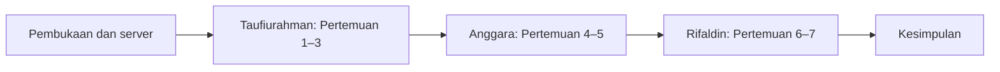

# Panduan dan Naskah Video Presentasi BangunSewa

Panduan ini membantu kelompok merekam presentasi proyek website BangunSewa.
Susunan, aksi layar, dan naskah disesuaikan dengan kode yang tersedia di
repositori. Contoh pada bagian naskah dapat dibaca langsung atau disesuaikan
dengan gaya bicara masing-masing anggota.

---

## 1. Tujuan Video

Video menjelaskan tujuan dan tampilan website BangunSewa, menunjukkan cara
menjalankan proyek, serta membahas materi pertemuan 1 sampai 7 sesuai
pembagian anggota:

| Anggota | Nama | Bagian presentasi |
| --- | --- | --- |
| Anggota 1 | Taufiurahman | Pertemuan 1–3: tujuan website, struktur HTML, styling responsif, dan interaksi DOM. |
| Anggota 2 | Anggara Aribawa Paramesti | Pertemuan 4–5: JSON, Fetch API, pemrosesan data dan endpoint PHP. |
| Anggota 3 | Muhammad Rifaldin | Pertemuan 6–7: PHP OOP dan arsitektur MVC. |

Estimasi durasi keseluruhan **12–16 menit**. Durasi ini fleksibel; utamakan
penjelasan kode dan bukti hasil berjalan daripada membaca terlalu cepat.

## 2. Persiapan Sebelum Merekam

### Periksa kebutuhan

- Pastikan PHP dapat dijalankan dari terminal dengan perintah `php -v`.
- Pastikan browser dan proyek dapat dibuka.
- Pastikan semua anggota telah mencoba bagian yang akan mereka presentasikan.
- Siapkan identitas/NIM setiap anggota jika diminta dosen.
- Siapkan URL repositori dan aturan pengumpulan dari instruksi dosen. Isikan
  URL dan ketentuan yang benar; panduan ini tidak mengasumsikan alamat
  repositori atau tenggat pengumpulan.

### Jalankan server

Dari terminal pada folder utama proyek, jalankan:

```powershell
php -S 127.0.0.1:8000
```

Jangan tutup terminal tersebut selama demo berlangsung. Pastikan dua jalur
halaman dapat dibuka:

- Frontend browser: <http://127.0.0.1:8000/>
- Halaman PHP MVC: <http://127.0.0.1:8000/backend/>

Frontend harus dijalankan melalui server HTTP agar JavaScript dapat mengambil
`backend/menu.json`. Jangan membuka halaman langsung dengan alamat `file://`.

### Jika perlu menunjukkan Git

Apabila instruksi dosen meminta demonstrasi proses clone, gunakan URL
repositori kelompok yang benar:

```powershell
git clone <URL_REPOSITORI_KELOMPOK>
cd <NAMA_FOLDER_REPOSITORI>
git log --oneline -n 10
php -S 127.0.0.1:8000
```

Ganti teks dalam tanda `<...>` dengan URL dan nama folder yang sebenarnya.
Jika proyek sudah berada di komputer dan clone tidak diminta, mulai rekaman
dari folder proyek yang sudah disiapkan.

## 3. Urutan Video dan Pembagian Tugas

| Segmen | Pembicara | Materi | Aksi utama |
| --- | --- | --- | --- |
| 1. Pembukaan dan menjalankan proyek | Muhammad Rifaldin | Identitas kelompok dan pengenalan proyek | Tampilkan terminal, jalankan server, buka frontend. |
| 2. Pertemuan 1–3 | Taufiurahman | Tujuan website, HTML, Tailwind responsif, interaksi menu | Jelaskan struktur `frontend/index.html`, uji halaman dan tampilan mobile. |
| 3. Pertemuan 4–5 | Anggara Aribawa Paramesti | JSON, Fetch API, PHP untuk data dan endpoint | Jelaskan `frontend/script.js`, `backend/menu.json`, PHP helper/API; tunjukkan katalog dan respons endpoint. |
| 4. Pertemuan 6–7 | Muhammad Rifaldin | OOP dan MVC | Jelaskan class/model/controller/view; uji katalog, filter, detail, dan ID tidak ditemukan. |
| 5. Kesimpulan | Muhammad Rifaldin atau semua anggota | Hasil dan pembagian materi | Ringkas fungsi website, batasan simulasi, dan kontribusi pertemuan. |



## 4. Berkas yang Dibuka Saat Presentasi

| Anggota | Berkas | Bagian yang dijelaskan |
| --- | --- | --- |
| Taufiurahman | `frontend/index.html` | Metadata halaman, konfigurasi Tailwind, navigasi, beranda, katalog, cara sewa, dan formulir. |
| Taufiurahman | `frontend/script.js` | Event menu mobile; boleh ditunjukkan sebagai contoh interaksi DOM. |
| Anggara Aribawa Paramesti | `backend/menu.json` | Bentuk data alat: ID, nama, kategori, deskripsi, gambar, dan harga. |
| Anggara Aribawa Paramesti | `frontend/script.js` | `apiUrl`, `fetchTools()`, `showApiTools()`, `renderCategoryFilters()`, pencarian, dan status loading/error. |
| Anggara Aribawa Paramesti | `backend/data/data_menu.php` | Pembacaan dan validasi data JSON oleh PHP. |
| Anggara Aribawa Paramesti | `backend/helpers/functions.php` | Format harga dan fungsi filter data. |
| Anggara Aribawa Paramesti | `backend/api.php` | Filter parameter `kategori`/`q` dan pembuatan respons JSON. |
| Muhammad Rifaldin | `backend/classes/Peralatan.php` | Properti, constructor, getter, format harga, dan method kartu. |
| Muhammad Rifaldin | `backend/models/PeralatanModel.php` | Konversi data menjadi objek dan pencarian berdasarkan ID. |
| Muhammad Rifaldin | `backend/controllers/PeralatanController.php` | Aksi katalog dan detail serta respons 404. |
| Muhammad Rifaldin | `backend/views/katalog_view.php`, `backend/views/detail_view.php` | HTML katalog dan detail yang dirender PHP. |
| Muhammad Rifaldin | `backend/index.php` | Pemilihan aksi `index` atau `show`. |

## 5. Peta Kode, Tujuan, dan Fungsi per Anggota

Bagian ini adalah panduan teknis inti untuk presentasi. Setiap anggota
menjelaskan **tujuan materi pertemuannya**, menunjukkan **kode yang
berhubungan**, menerangkan **fungsi kode**, lalu memperlihatkan **hasilnya di
website**. Potongan kode di bawah merupakan cuplikan untuk menjelaskan konsep;
beberapa sengaja diringkas dan bukan pengganti isi file proyek yang lengkap.

### Anggota 1 — Taufiurahman: Pertemuan 1, 2, dan 3

**Tujuan bagian anggota 1:** menjelaskan untuk siapa BangunSewa dibuat,
bagaimana halaman disusun dengan HTML, serta bagaimana tampilannya dibuat
responsif dan dapat berinteraksi.

#### Pertemuan 1 — Tujuan Website dan Beranda

**Berkas:** `frontend/index.html`

```html
<section id="beranda">
  <h2>
    Kerja lebih siap,<br>
    <span>tanpa beli alat.</span>
  </h2>
  <p>
    Sewa alat bangunan untuk kebutuhan harian proyekmu.
    Temukan alat yang tepat, cek harga, lalu ajukan permintaan sewa.
  </p>
  <a href="#alat">Jelajahi Katalog</a>
</section>
```

**Fungsi kode dan tampilannya:**

- `<section id="beranda">` menjadi bagian pembuka halaman.
- Judul dan paragraf menjelaskan tujuan layanan penyewaan alat.
- Tautan `href="#alat"` membawa pengunjung ke katalog di halaman yang sama.
- Pada website, bagian ini tampil sebagai area pembuka dengan teks promosi,
  tombol menuju katalog, dan gambar alat pilihan.

**Hasil yang ditunjukkan di browser:** jelaskan bahwa calon penyewa dapat
memahami fungsi website dari bagian pembuka lalu menuju daftar alat melalui
tombol **Jelajahi Katalog**.

#### Pertemuan 2 — Struktur HTML Halaman

**Berkas:** `frontend/index.html`

```html
<header>
  <nav aria-label="Navigasi utama">
    <a href="#beranda">Beranda</a>
    <a href="#alat">Katalog Alat</a>
    <a href="#cara-sewa">Cara Sewa</a>
    <a href="#kontak">Ajukan Sewa</a>
  </nav>
</header>

<main>
  <section id="beranda">...</section>
  <section id="alat">...</section>
  <section id="cara-sewa">...</section>
  <section id="kontak">...</section>
</main>
```

**Fungsi kode dan tampilannya:**

- `<header>` dan `<nav>` menampung navigasi.
- `<main>` menandai konten utama halaman.
- Setiap `<section>` memisahkan satu bagian website dan memiliki ID untuk
  dituju oleh tautan navigasi.
- Pada website, struktur ini membentuk urutan Beranda, Katalog, Cara Sewa,
  dan formulir Ajukan Sewa.
- `aria-label` memberikan nama yang jelas untuk navigasi, termasuk bagi
  teknologi bantu.

#### Pertemuan 3 — Styling Responsif dan Menu Mobile

**Berkas:** `frontend/index.html` dan `frontend/script.js`

Contoh layout responsif yang digunakan pada bagian Cara Sewa:

```html
<div class="grid grid-cols-3 gap-5 max-[800px]:grid-cols-1">
  <!-- Tiga kartu langkah cara sewa -->
</div>
```

Contoh interaksi tombol menu dari `frontend/script.js`:

```javascript
menuButton.addEventListener('click', function () {
  const isExpanded = menuButton.getAttribute('aria-expanded') === 'true';
  menuButton.setAttribute('aria-expanded', String(!isExpanded));
  menu.classList.toggle('max-[800px]:hidden');
});
```

**Fungsi kode dan tampilannya:**

- `grid-cols-3` menampilkan tiga kolom pada layar lebar.
- `max-[800px]:grid-cols-1` mengubahnya menjadi satu kolom pada layar yang
  lebarnya maksimal 800 piksel.
- Event `click` mengubah visibilitas navigasi mobile.
- `aria-expanded` menyimpan status menu terbuka atau tertutup.
- Pada browser, gunakan mode responsive DevTools untuk menunjukkan perubahan
  susunan dan tombol menu pada layar kecil.

**Ringkasan yang disampaikan anggota 1:** “Bagian saya berfokus pada tujuan
website untuk calon penyewa, struktur halaman HTML, dan tampilan responsif
yang memudahkan pengunjung berpindah dari beranda ke katalog dan formulir.”

### Anggota 2 — Anggara Aribawa Paramesti: Pertemuan 4 dan 5

**Tujuan bagian anggota 2:** menjelaskan bagaimana data alat disimpan terpisah,
diambil dan ditampilkan pada frontend, serta bagaimana PHP membaca,
memvalidasi, memfilter, dan menyediakan data katalog.

#### Pertemuan 4 — JSON dan Fetch API

**Berkas:** `backend/menu.json` dan `frontend/script.js`

Contoh bentuk satu objek alat:

```json
{
  "id": 1,
  "name": "Bor Tangan",
  "category": "Alat listrik",
  "description": "Bor listrik untuk membuat lubang pada kayu, logam, dan dinding.",
  "pricePerDay": 50000
}
```

Cuplikan pengambilan data dari fungsi `fetchTools()`:

```javascript
const apiUrl = '../backend/menu.json';

async function fetchTools() {
  try {
    const response = await fetch(apiUrl);
    if (!response.ok) {
      throw new Error(`Permintaan gagal (HTTP ${response.status}).`);
    }

    const data = await response.json();
    const tools = data?.tools;
    if (!Array.isArray(tools)) {
      throw new Error('Format data katalog tidak sesuai.');
    }

    availableTools = tools;
    renderCategoryFilters();
    showApiTools(tools);
  } catch (error) {
    const message = error instanceof Error
      ? error.message
      : 'Terjadi kesalahan yang tidak diketahui.';

    apiStatus.textContent = `Gagal memuat data: ${message}`;
    apiSpinner.classList.add('hidden');
    retryButton.classList.remove('hidden');
    console.error('[BangunSewa API] Detail error:', error);
  }
}
```

**Fungsi kode:**

- JSON menyimpan daftar alat terpisah dari HTML dan JavaScript.
- `fetch(apiUrl)` meminta data melalui HTTP.
- `response.ok` memeriksa keberhasilan respons.
- `response.json()` mengubah respons menjadi objek JavaScript.
- `Array.isArray(tools)` memastikan daftar alat memiliki format array.
- `showApiTools(tools)` mengirim data valid ke proses pembuatan katalog.

**Hasil yang ditunjukkan di browser:** katalog tampil dari JSON, pencarian
menyaring teks, filter kategori mengubah alat yang terlihat, tombol **Pilih
untuk disewa** mengisi formulir, dan lama sewa mengubah estimasi harga.

#### Pertemuan 5 — PHP untuk Membaca dan Menyaring Data

**Berkas:** `backend/data/data_menu.php`,
`backend/helpers/functions.php`, dan `backend/api.php`

Contoh membaca serta memvalidasi data JSON:

```php
function getDataMenu(): array
{
    $path = __DIR__ . '/../menu.json';
    $contents = file_get_contents($path);

    if ($contents === false) {
        throw new RuntimeException('Data katalog tidak dapat dibaca.');
    }

    $data = json_decode($contents, true, 512, JSON_THROW_ON_ERROR);

    if (!isset($data['tools']) || !is_array($data['tools'])) {
        throw new UnexpectedValueException('Format data katalog tidak valid.');
    }

    return $data['tools'];
}
```

Contoh fungsi helper untuk harga dan filter kategori:

```php
function formatRupiah(int|float $amount): string
{
    return 'Rp ' . number_format($amount, 0, ',', '.');
}

function saringMenuByKategori(array $menu, string $category): array
{
    if (trim($category) === '') {
        return $menu;
    }

    return array_values(array_filter(
        $menu,
        static fn(array $item): bool =>
            mb_strtolower($item['category'] ?? '', 'UTF-8')
            === mb_strtolower(trim($category), 'UTF-8')
    ));
}
```

**Fungsi kode:**

- `getDataMenu()` membaca file JSON dan mengubahnya menjadi array PHP.
- `formatRupiah()` menyajikan harga dengan pemisah ribuan yang mudah dibaca.
- `saringMenuByKategori()` memilih data berdasarkan kategori.
- `backend/api.php` memanggil fungsi data/filter dan mengirim hasil JSON.
- Endpoint dapat dicoba di `/backend/api.php?kategori=Alat%20listrik` atau
  `/backend/api.php?q=bor`.

**Catatan penting saat presentasi:** halaman frontend mengambil
`backend/menu.json` secara langsung, bukan memanggil `backend/api.php`.
Endpoint API PHP tetap dapat ditunjukkan terpisah sebagai implementasi
pertemuan 5.

**Ringkasan yang disampaikan anggota 2:** “Bagian saya menjelaskan perjalanan
data dari JSON, pengambilan asynchronous menggunakan Fetch API, hingga
pembacaan dan penyaringan data katalog menggunakan PHP.”

### Anggota 3 — Muhammad Rifaldin: Pertemuan 6 dan 7

**Tujuan bagian anggota 3:** menjelaskan bagaimana data alat dimodelkan
menjadi objek PHP dan bagaimana halaman PHP diatur menggunakan Model,
Controller, dan View.

#### Pertemuan 6 — Class dan Objek PHP

**Berkas:** `backend/classes/Peralatan.php` dan
`backend/models/PeralatanModel.php`

Contoh class yang digunakan:

```php
class Peralatan
{
    public function __construct(
        private int $id,
        private string $name,
        private string $imageUrl,
        private string $imageSource,
        private string $category,
        private string $description,
        private int $pricePerDay
    ) {
    }

    public function getId(): int { return $this->id; }
    public function getName(): string { return $this->name; }
    public function getPricePerDay(): int { return $this->pricePerDay; }
}
```

**Fungsi kode:**

- `class Peralatan` menjadi cetak biru untuk objek satu alat bangunan.
- Constructor mengisi properti saat objek dibuat.
- Tipe `int` dan `string` menjelaskan jenis nilai yang diterima.
- `private` membatasi akses langsung; getter memberikan cara untuk membaca
  nilai properti.
- Class lengkap juga memiliki method format harga, `isBestSeller()`, dan
  `renderKartu()`. Pada view MVC saat ini, kartu katalog dirender langsung
  oleh `katalog_view.php` menggunakan getter objek.

`PeralatanModel::getAll()` membaca data katalog dan mengubah setiap array
menjadi objek `Peralatan`; `findById()` mencari satu objek berdasarkan ID.

**Hasil yang ditunjukkan:** buka class dan model untuk menunjukkan bahwa data
alat tidak hanya berupa array mentah, tetapi dikemas sebagai objek dengan
method yang berkaitan.

#### Pertemuan 7 — Model-View-Controller (MVC)

**Berkas:** `backend/index.php`,
`backend/controllers/PeralatanController.php`,
`backend/models/PeralatanModel.php`, dan `backend/views/`

Contoh alur Controller:

```php
public function index(): void
{
    $kategori = trim((string) ($_GET['kategori'] ?? ''));
    $daftarAlat = $this->model->getAll($kategori);
    require __DIR__ . '/../views/katalog_view.php';
}

public function show(): void
{
    $id = filter_input(INPUT_GET, 'id', FILTER_VALIDATE_INT);
    $alat = $id === false || $id === null
        ? null
        : $this->model->findById($id);

    if ($alat === null) {
        http_response_code(404);
    }

    require __DIR__ . '/../views/detail_view.php';
}
```

**Fungsi kode:**

- **Model** membaca, memfilter, dan mencari data alat.
- **Controller** menerima parameter URL, meminta data dari Model, lalu
  memilih View yang akan ditampilkan.
- **View** membuat HTML katalog atau detail dari data yang diberikan.
- `http_response_code(404)` menandai alat yang tidak ditemukan sebagai
  respons 404.
- `backend/index.php` memilih method controller dari parameter `action`.

**Hasil yang ditunjukkan di browser:**

1. `/backend/` — halaman katalog PHP.
2. `/backend/?kategori=Alat%20listrik` — katalog difilter menurut kategori.
3. `/backend/?action=show&id=1` — detail alat dengan ID 1.
4. `/backend/?action=show&id=999` — tampilan alat tidak ditemukan.

**Ringkasan yang disampaikan anggota 3:** “Bagian saya menjelaskan bagaimana
data alat dibentuk menjadi objek PHP, kemudian bagaimana Model, Controller,
dan View bekerja sama untuk menampilkan katalog maupun detail alat.”

---

## 6. Naskah Presentasi dan Aksi Layar

### Segmen 1 — Pembukaan dan Menjalankan Proyek

**Pembicara:** Muhammad Rifaldin  
**Durasi:** sekitar 1 menit

**Aksi layar:**

1. Tampilkan folder proyek atau terminal pada root repositori.
2. Jika diwajibkan dosen, lakukan `git clone` menggunakan URL kelompok dan
   tunjukkan `git log`. Jika tidak, lanjutkan dari folder proyek.
3. Jalankan server PHP:

   ```powershell
   php -S 127.0.0.1:8000
   ```

4. Buka <http://127.0.0.1:8000/> di browser.

**Naskah bicara:**

> “Assalamu’alaikum warahmatullahi wabarakatuh. Perkenalkan, kami dari
> kelompok [nama kelompok/kelas]. Pada video ini kami akan mempresentasikan
> proyek BangunSewa, yaitu website katalog penyewaan alat bangunan untuk
> kebutuhan proyek dan renovasi.”
>
> “Website ini menampilkan informasi alat dan harga sewa per hari. Pengunjung
> dapat mencari dan memfilter katalog, melihat cara menyewa, serta mencoba
> formulir permintaan sewa yang masih berupa simulasi.”
>
> “Saya Muhammad Rifaldin. Saya akan memulai server lokal agar halaman frontend
> dan halaman PHP dapat diperlihatkan langsung di browser. Selanjutnya,
> Taufiurahman akan menjelaskan materi pertemuan 1 sampai 3.”

### Segmen 2 — Taufiurahman: Pertemuan 1–3

**Durasi:** sekitar 3–4 menit

#### Pertemuan 1 — Tujuan Website

**Aksi layar:**

1. Tampilkan beranda BangunSewa pada browser.
2. Tunjukkan judul, deskripsi, tombol **Jelajahi Katalog**, dan gambar alat.
3. Pada VS Code, buka `frontend/index.html` dan cari bagian `section`
   ber-ID `beranda`.

**Naskah bicara:**

> “Saya Taufiurahman, membahas materi pertemuan 1 sampai 3. Pada pertemuan 1,
> kami menentukan tujuan website. BangunSewa ditujukan untuk membantu calon
> penyewa mencari alat bangunan tanpa perlu membeli alat yang hanya digunakan
> sementara.”
>
> “Pada bagian beranda, pengunjung mendapat gambaran tentang layanan dan
> dapat menekan tombol Jelajahi Katalog untuk langsung menuju daftar alat.
> Informasi harga ditampilkan per hari agar calon penyewa dapat
> membandingkan pilihan.”

#### Pertemuan 2 — Struktur HTML

**Aksi layar:**

1. Pada `frontend/index.html`, tunjukkan `<header>`, `<nav>`, `<main>`,
   beberapa `<section>`, formulir, dan `<footer>`.
2. Klik navigasi **Katalog Alat** atau **Cara Sewa** pada browser agar terlihat
   tautan menuju section yang sesuai.

**Naskah bicara:**

> “Pada pertemuan 2, kami menyusun halaman dengan HTML. Elemen header dan nav
> digunakan untuk navigasi. Elemen main menjadi pembungkus konten utama, lalu
> beberapa section memisahkan beranda, katalog, cara sewa, dan formulir.
> Footer digunakan untuk informasi penutup.”
>
> “Pemisahan ini membuat struktur halaman lebih teratur. Tautan navigasi
> menggunakan ID section, misalnya `#alat`, sehingga pengguna dapat berpindah
> ke bagian katalog pada halaman yang sama.”

#### Pertemuan 3 — Styling Responsif dan Interaksi DOM

**Aksi layar:**

1. Tunjukkan utility Tailwind seperti `grid`, `max-[800px]:grid-cols-1`,
   `max-[600px]:grid-cols-1`, dan warna tema.
2. Di browser, buka DevTools responsive mode lalu ubah ukuran viewport.
3. Klik tombol menu ketika viewport kecil.
4. Opsional: ketik nama alat pada kotak pencarian dan pilih kategori.

**Naskah bicara:**

> “Pada pertemuan 3, kami menyusun tampilan dengan Tailwind CSS. Utility
> breakpoint digunakan untuk mengubah susunan kolom pada layar kecil. Sebagai
> contoh, cara sewa yang berbentuk tiga kolom pada layar lebar berubah menjadi
> satu kolom ketika lebar layar maksimal 800 piksel.”
>
> “JavaScript juga berinteraksi dengan DOM. Tombol menu mengubah class
> visibilitas navigasi, dan atribut `aria-expanded` menyatakan apakah menu
> sedang terbuka. Di bagian katalog, event input dan klik digunakan untuk
> memperbarui hasil pencarian dan kategori.”
>
> “Demikian penjelasan pertemuan 1 sampai 3. Selanjutnya Anggara akan
> menjelaskan JSON, Fetch API, dan pengolahan data PHP.”

### Segmen 3 — Anggara Aribawa Paramesti: Pertemuan 4–5

**Durasi:** sekitar 4–5 menit

#### Pertemuan 4 — JSON dan Fetch API

**Aksi layar:**

1. Buka `backend/menu.json` dan tunjukkan salah satu objek alat.
2. Buka `frontend/script.js`, cari `const apiUrl`, lalu fungsi `fetchTools()`.
3. Jelaskan `fetch`, `response.ok`, `response.json()`, dan validasi array.
4. Kembali ke frontend. Coba pencarian dan kategori, pilih satu alat, lalu
   ubah lama sewa untuk menunjukkan estimasi.
5. Tunjukkan status pemuatan dan bagian log fetch. Untuk error, cukup jelaskan
   penanganannya di kode; jangan mengubah atau menghapus file proyek saat demo.

**Naskah bicara:**

> “Saya Anggara Aribawa Paramesti, membahas pertemuan 4 dan 5. Pada pertemuan
> 4, data katalog disimpan terpisah dalam format JSON. Setiap alat memiliki
> ID, nama, gambar, kategori, deskripsi, dan harga sewa per hari.”
>
> “Di `frontend/script.js`, alamat sumber data disimpan pada `apiUrl`.
> Fungsi `fetchTools()` menggunakan `async` dan `await` untuk meminta
> `backend/menu.json`. Respons diperiksa dengan `response.ok`, lalu isinya
> dibaca menggunakan `response.json()`. Setelah itu, program memeriksa bahwa
> properti `tools` berbentuk array.”
>
> “Fungsi `showApiTools()` menyusun kartu katalog dan pilihan alat pada
> formulir secara dinamis. Pengunjung juga dapat mencari nama atau deskripsi,
> memfilter kategori, melihat lebih banyak kartu, dan melihat estimasi biaya
> dari harga harian dikalikan lama sewa.”
>
> “Ketika data sedang dimuat, halaman menampilkan status dan spinner. Jika
> permintaan gagal, halaman menampilkan pesan error dan tombol Muat Ulang.
> Prosesnya juga dicatat di panel log dan Console.”

#### Pertemuan 5 — PHP Prosedural dan Endpoint Data

**Aksi layar:**

1. Buka `backend/data/data_menu.php`, jelaskan pembacaan JSON serta validasi.
2. Buka `backend/helpers/functions.php`, tunjukkan `formatRupiah()`,
   `saringMenu()`, dan `saringMenuByKategori()`.
3. Buka `backend/api.php`, jelaskan parameter query dan `json_encode()`.
4. Tampilkan endpoint di browser:
   - <http://127.0.0.1:8000/backend/api.php>
   - <http://127.0.0.1:8000/backend/api.php?kategori=Alat%20listrik>
   - <http://127.0.0.1:8000/backend/api.php?q=bor>

**Naskah bicara:**

> “Pada pertemuan 5, PHP juga digunakan untuk membaca dan memproses data.
> Fungsi `getDataMenu()` membaca file JSON dan memeriksa formatnya. File
> helper berisi fungsi untuk memformat Rupiah dan menyaring daftar berdasarkan
> kategori atau kata kunci.”
>
> “File `backend/api.php` mengirim hasil dalam format JSON dan dapat menerima
> parameter `kategori` maupun `q`. Di browser terlihat bahwa hasil endpoint
> dapat berubah sesuai parameter yang diberikan.”
>
> “Perlu dibedakan bahwa frontend saat ini mengambil file `menu.json`
> langsung. Endpoint PHP yang baru saya tunjukkan merupakan jalur PHP yang
> tersedia terpisah, bukan alamat yang dipanggil oleh `fetchTools()`.”
>
> “Demikian pertemuan 4 dan 5. Berikutnya Muhammad Rifaldin akan menjelaskan
> pemodelan OOP dan arsitektur MVC.”

### Segmen 4 — Muhammad Rifaldin: Pertemuan 6–7

**Durasi:** sekitar 4–5 menit

#### Pertemuan 6 — PHP OOP

**Aksi layar:**

1. Buka `backend/classes/Peralatan.php`.
2. Tunjukkan typed properties, constructor, getter, `getHargaFormatted()`,
   `isBestSeller()`, dan `renderKartu()`.
3. Buka `backend/models/PeralatanModel.php`. Tunjukkan `getAll()` dan
   `findById()`.

**Naskah bicara:**

> “Saya Muhammad Rifaldin, membahas pertemuan 6 dan 7. Pada pertemuan 6,
> data alat dimodelkan menggunakan class `Peralatan`. Class memiliki properti
> bertipe untuk ID, nama, alamat gambar, kategori, deskripsi, dan harga.”
>
> “Constructor mengisi nilai saat objek dibuat. Properti dibuat private dan
> dibaca melalui getter. Class juga memiliki method untuk memformat harga,
> menentukan alat pilihan, dan menghasilkan markup kartu.”
>
> “`PeralatanModel` mengubah data JSON menjadi kumpulan objek `Peralatan`.
> Model juga dapat mencari objek berdasarkan ID. Dengan objek, data dan
> perilaku yang berkaitan dengan sebuah alat dikelompokkan bersama.”

#### Pertemuan 7 — Arsitektur MVC

**Aksi layar:**

1. Tampilkan struktur folder `backend/classes`, `models`, `controllers`,
   dan `views`.
2. Buka `backend/index.php` dan jelaskan pemilihan `action`.
3. Buka `backend/controllers/PeralatanController.php`; tunjukkan method
   `index()` dan `show()`.
4. Buka `backend/models/PeralatanModel.php`.
5. Buka `backend/views/katalog_view.php` dan `detail_view.php`.

**Naskah bicara:**

> “Pada pertemuan 7, halaman PHP menggunakan pola MVC untuk membagi tanggung
> jawab. Model mengelola data, Controller mengatur alur permintaan, dan View
> menampilkan hasil kepada pengguna.”
>
> “`backend/index.php` menjadi router sederhana yang memilih aksi katalog
> atau detail. `PeralatanController` meminta daftar alat ke Model dan
> meneruskan data ke View yang sesuai. Jika ID alat tidak ditemukan, controller
> mengatur status 404 dan View detail menampilkan pesan yang sesuai.”

#### Demo Langsung Halaman MVC

**Aksi layar dan URL:**

1. Katalog PHP: <http://127.0.0.1:8000/backend/>
2. Filter kategori:
   <http://127.0.0.1:8000/backend/?kategori=Alat%20listrik>
3. Detail alat:
   <http://127.0.0.1:8000/backend/?action=show&id=1>
4. ID yang tidak tersedia:
   <http://127.0.0.1:8000/backend/?action=show&id=999>

**Naskah bicara:**

> “Sekarang saya menunjukkan hasil MVC secara langsung. Halaman
> `/backend/` menampilkan katalog yang dirender oleh View berdasarkan data dari
> Model. Parameter kategori menyaring alat pada sisi server.”
>
> “Saat aksi `show` dan ID alat diberikan, Controller mencari alat tersebut
> dan menampilkan halaman detail. Jika ID 999 tidak tersedia, aplikasi
> memberikan status 404 dan menampilkan informasi bahwa alat tidak ditemukan.”
>
> “Dengan demikian, pertemuan 6 membahas pembentukan objek PHP, sedangkan
> pertemuan 7 membahas pemisahan tanggung jawab melalui MVC.”

### Segmen 5 — Kesimpulan

**Pembicara:** Muhammad Rifaldin, boleh ditutup dengan ucapan semua anggota  
**Durasi:** sekitar 1 menit

**Aksi layar:**

1. Tampilkan kembali halaman katalog BangunSewa atau slide ringkasan.
2. Tampilkan nama anggota dan rentang pertemuan masing-masing.

**Naskah bicara:**

> “Sebagai kesimpulan, BangunSewa adalah website katalog penyewaan alat
> bangunan yang membantu pengunjung melihat informasi alat dan harga harian.
> Proyek ini menerapkan materi dari struktur HTML dan tampilan responsif,
> Fetch API dan pemrosesan PHP, hingga OOP dan MVC.”
>
> “Pembagian materi kami adalah Taufiurahman pada pertemuan 1 sampai 3,
> Anggara Aribawa Paramesti pada pertemuan 4 dan 5, serta Muhammad Rifaldin
> pada pertemuan 6 dan 7. Formulir frontend masih berupa simulasi dan belum
> mengirim atau menyimpan permintaan sewa.”
>
> “Demikian presentasi dari kelompok kami. Terima kasih atas perhatian
> Bapak/Ibu dosen. Wassalamu’alaikum warahmatullahi wabarakatuh.”

## 7. Checklist Sebelum Mengakhiri Rekaman

- [ ] Server berhasil dijalankan dan frontend tampil.
- [ ] Tujuan serta tampilan website telah diterangkan.
- [ ] Masing-masing anggota menyampaikan pertemuan yang menjadi bagiannya.
- [ ] Contoh kode dijelaskan bersama hasil yang terlihat di browser.
- [ ] Endpoint PHP disebut sebagai jalur terpisah; tidak diklaim sebagai sumber
      fetch frontend.
- [ ] Formulir disebut sebagai simulasi, bukan pemesanan yang tersimpan.
- [ ] Nama/NIM, URL repositori, dan informasi pengumpulan telah diperiksa.
- [ ] Semua anggota mendapat porsi presentasi dan suara yang jelas.

## 8. Catatan Teknis agar Demo Sesuai Kode

- Frontend berada di `frontend/index.html`, sementara logika katalog berada di
  `frontend/script.js`.
- Fetch frontend menggunakan alamat relatif `../backend/menu.json`.
- Endpoint `backend/api.php` menerima filter `kategori` dan kata kunci `q`,
  tetapi frontend tidak memanggil endpoint tersebut.
- Halaman PHP MVC berada di `backend/` dan menggunakan
  `backend/index.php` sebagai titik masuk.
- URL aksi detail memakai `?action=show&id=...`.
- Formulir pada frontend mencegah submit biasa dan hanya menampilkan pesan
  simulasi; tidak ada penyimpanan atau pengiriman pesanan.
- Gambar katalog menggunakan alamat eksternal, sehingga tampilan foto
  memerlukan koneksi internet.
